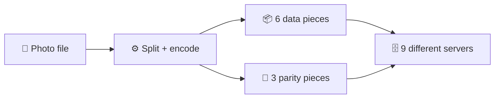

# 04 · Erasure Coding

> [!info] Topic info
> **Subject:** System Design · **Chapter:** Storage Systems · **Priority:** 💤 Low · **Status:** ✅ done · **Last reviewed:** 2026-11-19
>
> [← Back to Storage Systems](README.md) · [Interview questions →](questions/storage-systems-qa.md)

> [!abstract] In one line
> **Erasure coding** splits data into **k data pieces** plus **m parity pieces**, so any **k** of them can rebuild the original — the same safety as replication for about **half the extra storage**.

---

## 1. The problem

Our photo store holds **10 PB**. With classic **3x replication**, we pay for **30 PB** of disk — 20 PB just for safety.

At this scale, that's millions of dollars a year. Can we survive the same number of disk failures while storing less?

---

## 2. How it works

Take a file, cut it into **k = 6** data pieces. Use math (Reed–Solomon codes) to compute **m = 3** extra **parity** pieces. Store all 9 pieces on 9 different disks or servers.

Any **6 of the 9** pieces are enough to rebuild the file. So you can lose **any 3** and still be fine.

> [!example] Simple intuition
> With 2 numbers, 4 and 7, store a third piece: their sum 11. Lose any one and you can recompute it. Real erasure codes do the same idea with smarter math to survive several losses.

---

## 3. Replication vs erasure coding

| | 3x Replication | Erasure coding 6+3 |
|---|---|---|
| **Storage overhead** | 3x (200% extra) | 1.5x (50% extra) |
| **Failures survived** | 2 | 3 |
| **Read** | Read any one copy — fast | Read from 6 servers, maybe decode |
| **Rebuild after a disk dies** | Copy 1 replica | Read 6 pieces + compute — heavy on network and CPU |
| **Best for** | Hot data, small objects, low latency | Cold / large data, archives |

> [!tip] 🎤 Say it like this
> "Replication keeps full copies — 3x storage, survives two failures. Erasure coding with 6 data plus 3 parity pieces survives three failures with only 1.5x storage. The catch is rebuilds and reads touch many servers and need CPU, so it's used for large, colder data, while hot data often stays replicated."

> [!failure] Interview traps
> - Saying erasure coding is "always better" — it trades storage for **slower reads, costly rebuilds**, and more complexity.
> - Putting pieces on the same rack — one rack failure kills several pieces. Spread them across racks or AZs.
> - Confusing it with RAID — RAID 5/6 is a small, single-machine form of the same idea.

---

## Summary

- **k data + m parity** pieces; any **k** rebuild the data; survive **m** losses.
- 6+3 → **1.5x** storage vs **3x** for replication, and survives more failures.
- Cost: more network + CPU on reads and rebuilds.
- Used by S3-like object stores, HDFS 3, and cold-storage tiers.

> [!success] Key takeaway
> Replication buys speed, erasure coding buys cheap durability. Hot data → replicate. Big, cold data → erasure code.
