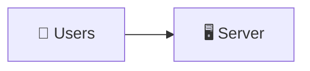

# NN · Topic Name

> [!info] Topic info
> **Subject:** <!-- e.g. System Design --> · **Priority:** 🔥 High · **Status:** 🚧 in progress · **Last reviewed:** YYYY-MM-DD
>
> [← Back to Subject](README.md) · [Interview questions →](questions/NN-topic-qa.md)

> [!abstract] In one line
> One-sentence definition with the **key words** in bold.

---

## 1. The problem

A relatable scenario (running example) that shows why this topic exists.

> [!tip] 🎤 Say it like this
> "2–4 sentences you can say out loud in an interview."

---

## 2. Concept / solution

Short paragraphs (2–3 lines).

**✅ Pros**
- …

**❌ Cons**
- …

> [!warning] Trap / trade-off
> What gets harder.

---

## Summary

| Step | Fixes this |
|---|---|
| **…** | … |

> [!success] Key takeaway
> One or two lines.

---

## References

- [Resource name](https://example.com)
